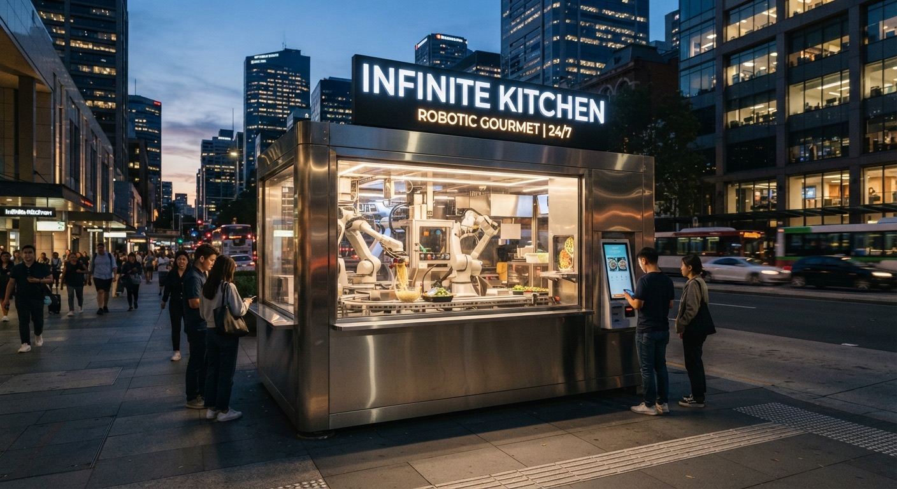
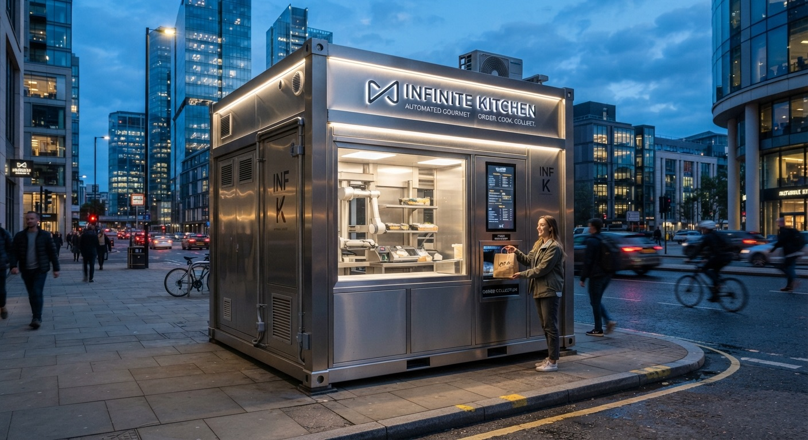
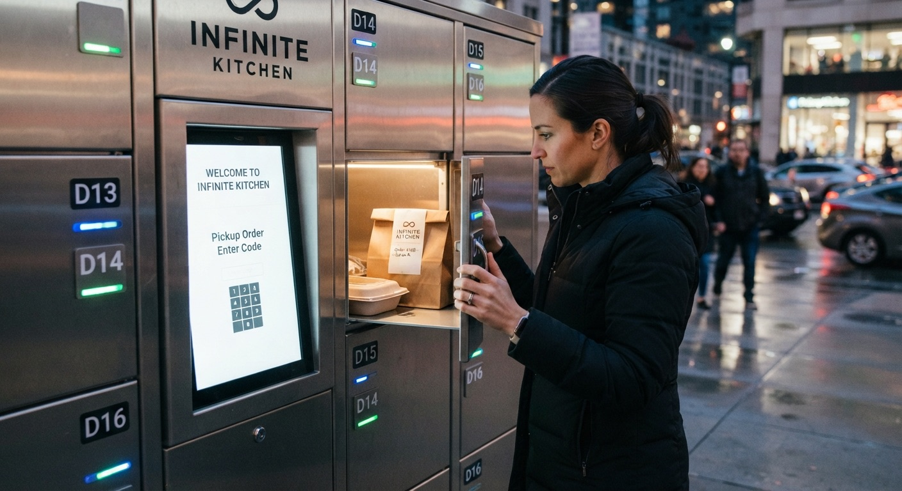
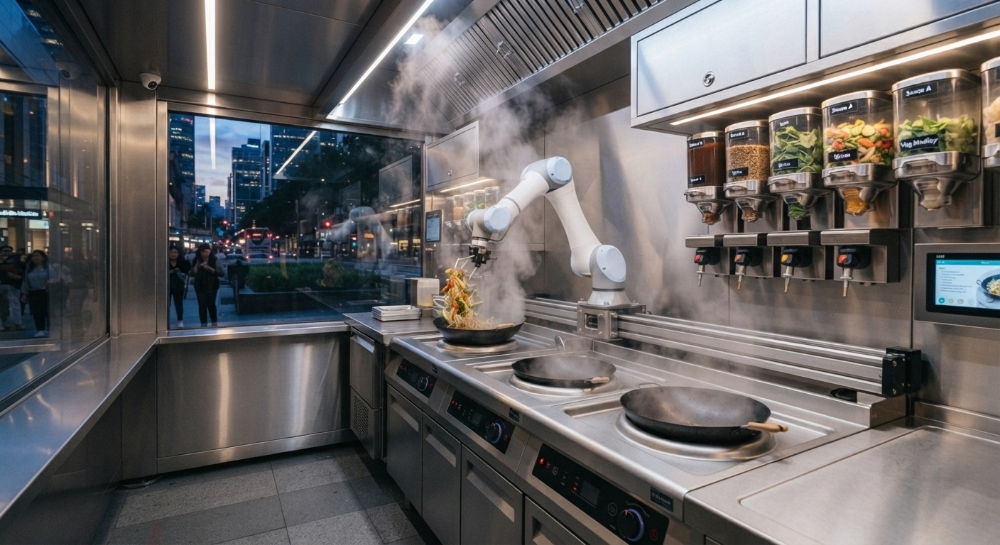
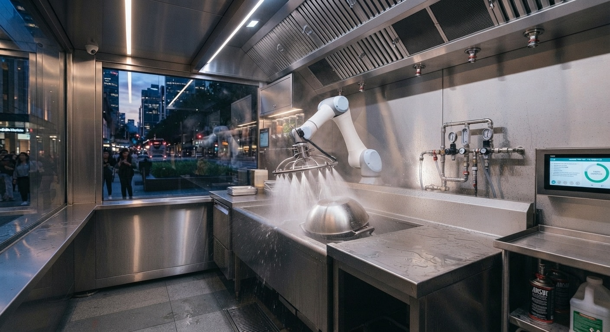
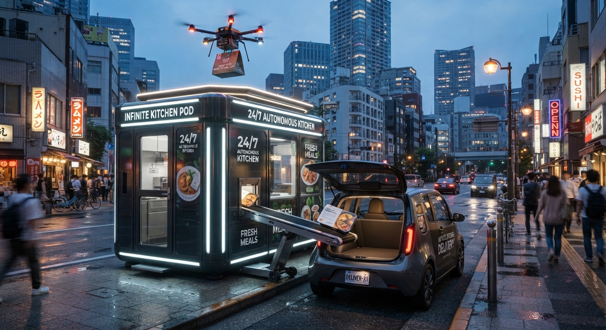
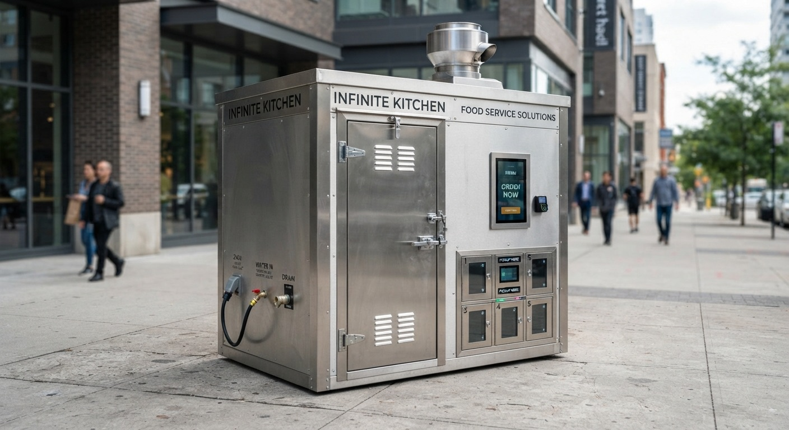
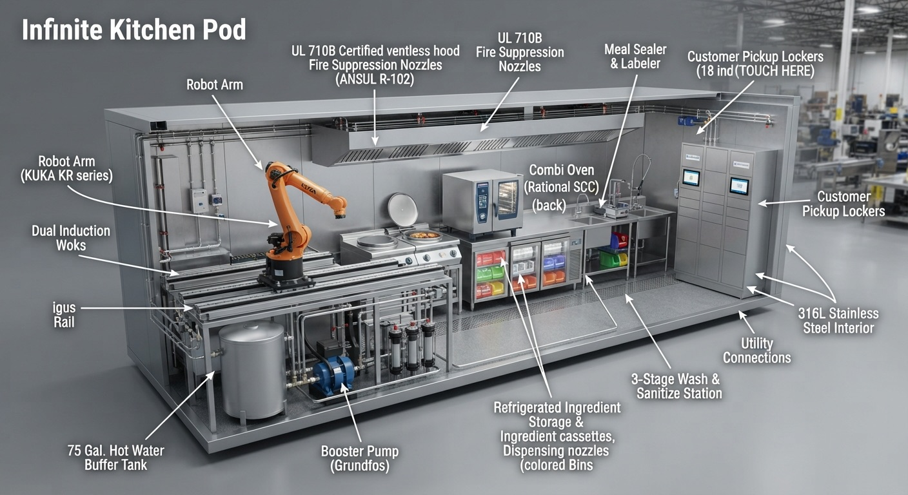

# The Infinite Kitchen Pod

**Low prices. Rich, quality ingredients. Eating out, made affordable.**

**The goal is to bring the cost of food down for people who like to eat out.** The Infinite Kitchen Pod is a self-cleaning robotic kitchen that cooks restaurant meals with real, quality ingredients. The meals cost less because the kitchen is automated, not because the food is worse.

**In one sentence:** an open-hardware design for a modular, self-cleaning robotic kitchen pod that stores, cooks, washes, packs and hands off up to 90 hot meals an hour from a footprint small enough for a sidewalk or a parking spot.

**Status:** early concept. The architecture, the bill of materials, the water and power math and a full set of renders are here. No prototype has been built yet, and there are real engineering problems still open ([help wanted](#status-early-concept-help-wanted)).

**Live site:** https://nicedreamzapp.github.io/infinite-kitchen-pod/
**Investor brochure (6 pages, print ready):** https://nicedreamzapp.github.io/infinite-kitchen-pod/brochure.html

## What the pod is

A pod about the size of a parking space that runs a full kitchen on its own:

- **Cold storage and dosing.** A refrigerated zone holds ingredient cartridges that a person restocks once a day. Load-cell dispensers portion dry and diced ingredients to about half a gram; pumps dose sauces and oils.
- **Cooking.** A 6-axis collaborative arm on a linear track works two 5 kW induction woks and a ventless multi-cook oven. Wok sear, steam, bake, pasta and cold bowls.
- **Self-cleaning.** After every meal the wok and tools get a 3-stage wash: a hot water blast, an ultrasonic sanitizer dip and a 180°F rinse. Off-peak, a full clean-in-place cycle sprays the cell down with rotating spray balls into a sloped stainless basin.
- **Packing and handoff.** Meals are heat-sealed, labeled and delivered to heated and chilled pickup lockers, a delivery vehicle bay, or a rooftop drone pad.
- **Self-contained.** A UL 710B ventless hood and UL 300 fire suppression mean no ductwork, so the pod can go where a restaurant can't.

## Cheaper meals, same good food

A big share of what you pay for when you eat out is the kitchen around the food: rent, buildout and staff. The pod shrinks all three and keeps spending on ingredients.

| | |
|---|---|
| **$12** | average meal price in the operating model (estimate) |
| **28%** | of every ticket goes to food and packaging, so ingredients stay a priority |
| **About $0.53** | of labor per meal: one fleet tech covers five pods (estimate) |
| **90 meals an hour** | peak, about 1,200 a day |
| **±0.5 g** | portion accuracy, the same recipe every time |

And for whoever owns one:

| | |
|---|---|
| **$185,000** | target turnkey price (early estimate) |
| **4.5 months** | simple payback in the brochure model |
| **$41,500** | estimated net operating profit per month at 750 meals a day |
| **$72,450** | estimated direct hardware BOM |

These numbers come from the revised brochure and are early estimates. The audit document uses more conservative figures, and reconciling the two is one of the [open issues](https://github.com/nicedreamzapp/infinite-kitchen-pod/issues/8).

## Two ways to get one

The [brochure](https://nicedreamzapp.github.io/infinite-kitchen-pod/brochure.html) lays out two plans (early estimates):

- **Plan 1, turnkey purchase:** $185,000 per pod upfront, a $1,200 a month cloud platform fee, 4.5 month simple payback.
- **Plan 2, robot as a service:** $15,000 for site setup and commissioning, then $8,500 a month covering hardware, software, telemetry, maintenance and replacement parts.

Either way the operator's costs stay low, so the menu prices can too.

## Gallery

| | |
|---|---|
|  |  |
| **Pod overview** | **Curbside in the city** |
|  |  |
| **Pickup lockers** | **Robot arm and woks** |
|  |  |
| **Wash station** | **Drone and car delivery** |
|  |  |
| **Exterior to CAD spec** | **Cutaway, all parts** |

Full resolution originals are in [`Images/`](Images/).

## How it compares

Other companies are automating kitchens, but with closed designs, and most automate one station inside a kitchen someone already built. As far as we can find, nobody has published an open, end-to-end design like this one.

| Company | What it does | Price |
|---|---|---|
| Miso Robotics (Flippy) | Robotic fry station inside an existing kitchen | About $3,000 per month, rented ([source](https://www.fox2detroit.com/news/white-castle-hiring-robots-to-give-the-right-tools-for-serving-more-hot-and-tasty-food)) |
| Botinkit (ChefBot) | Wok cooking robot inside an existing kitchen | $43,000, or a monthly plan ([source](https://www.robotlab.com/store/botinkit/)) |
| Hyper Food Robotics | Containerized robotic restaurant | Not published |
| Nala Robotics (Pizzaiola) | Robotic pizza and multi-cuisine kitchen | Lease from about $7,000 per month, reported 2022 ([source](https://fortune.com/2022/10/18/tech-forward-everyday-ai-robots-pizza/)) |
| Moley Robotics | Dual-arm robotic kitchen for luxury homes | About $335,000, reported at launch ([source](https://thespoon.tech/moleys-robotic-kitchen-goes-on-sale/)) |

The pod is the whole kitchen, it is owned instead of rented, and it is open. All three keep menu prices low while the ingredients stay good. Details: [docs/competition.md](docs/competition.md).

## Deploy as a pod, or drop it into an existing kitchen

- **Into a second-generation kitchen.** A gutted restaurant space that still has its hood, fire suppression, grease trap and plumbing saves an estimated **$67,000 to $238,000** in buildout. The cooking cell drops in and reuses all of it.
- **As a self-contained pod.** Its own ventless hood and clean-in-place system let it sit on a sidewalk or in a parking lot, with no ductwork, no walls and no restaurant lease.

Either way, the money not spent on buildout and rent is money that does not have to be charged for the meal. Details: [docs/retrofit-existing-kitchen.md](docs/retrofit-existing-kitchen.md).

## Docs

| File | What it is |
|---|---|
| [brochure.html](brochure.html) | The 6-page investor brochure (print to PDF from the browser) |
| [docs/revised-cad-bom.pdf](docs/revised-cad-bom.pdf) | Revised CAD layout, BOM, P&L and sanitation protocol (2 pages) |
| [docs/technical-audit.md](docs/technical-audit.md) | Engineering and financial audit: water heating, arm timing, BOM, P&L, hood and fire, materials, allergens |
| [docs/cip-spec.md](docs/cip-spec.md) | Clean-in-place sanitation hardware and regulatory blueprint |
| [docs/cip-hardware-sanitation-system.html](docs/cip-hardware-sanitation-system.html) | Interactive 3D view of the clean-in-place hardware ([open it live](https://nicedreamzapp.github.io/infinite-kitchen-pod/docs/cip-hardware-sanitation-system.html)) |
| [docs/competition.md](docs/competition.md) | How the pod compares to commercial kitchen robots, with sourced prices |
| [docs/retrofit-existing-kitchen.md](docs/retrofit-existing-kitchen.md) | Pod vs. dropping into an existing second-generation kitchen |

## Status: early concept, help wanted

This is a concept with real open problems. Each one below is a [help wanted issue](https://github.com/nicedreamzapp/infinite-kitchen-pod/issues?q=is%3Aissue+label%3A%22help+wanted%22). If you know the field, jump in.

1. **[Hot water buffer sizing](https://github.com/nicedreamzapp/infinite-kitchen-pod/issues/1).** Each full CIP run needs about 142 gallons of 180°F water and the design carries a 75 gallon tank.
2. **[Single-arm, dual-wok throughput](https://github.com/nicedreamzapp/infinite-kitchen-pod/issues/2).** The 38 second per meal cycle works on paper and needs a prototype to prove it.
3. **[BOM and price](https://github.com/nicedreamzapp/infinite-kitchen-pod/issues/3).** The BOM and the $185k price are early estimates from list prices, not quotes.
4. **[Hood and fire suppression](https://github.com/nicedreamzapp/infinite-kitchen-pod/issues/4).** Integration details for the UL 710B ventless hood and UL 300 suppression.
5. **[Material choices](https://github.com/nicedreamzapp/infinite-kitchen-pod/issues/5).** Induction wok metal, peristaltic tubing vs. diaphragm pumps, and the arm's washdown rating.
6. **[Allergen carryover](https://github.com/nicedreamzapp/infinite-kitchen-pod/issues/6).** The wash protocol needs real carryover testing.
7. **[Certification path](https://github.com/nicedreamzapp/infinite-kitchen-pod/issues/7).** NSF 4/7, UL 197/471/508A, R15.06 / ISO 10218.
8. **[Reconcile the numbers](https://github.com/nicedreamzapp/infinite-kitchen-pod/issues/8).** Footprint, amperage and finance figures differ across the docs.

## License

- **Hardware design** (layouts, CAD, BOM and hardware specifications): [CERN Open Hardware Licence v2, Strongly Reciprocal](LICENSE) (CERN-OHL-S-2.0)
- **Documentation and images** (this README, the site, the brochure, `docs/` and `Images/`): [Creative Commons Attribution-ShareAlike 4.0](LICENSE-DOCS) (CC BY-SA 4.0)

Copyright Matt Macosko.
